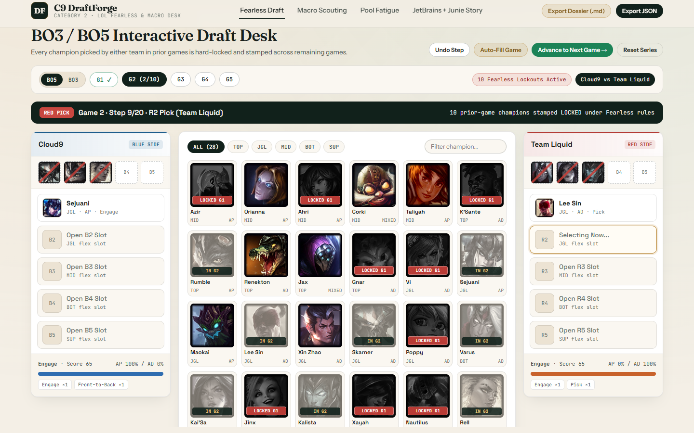
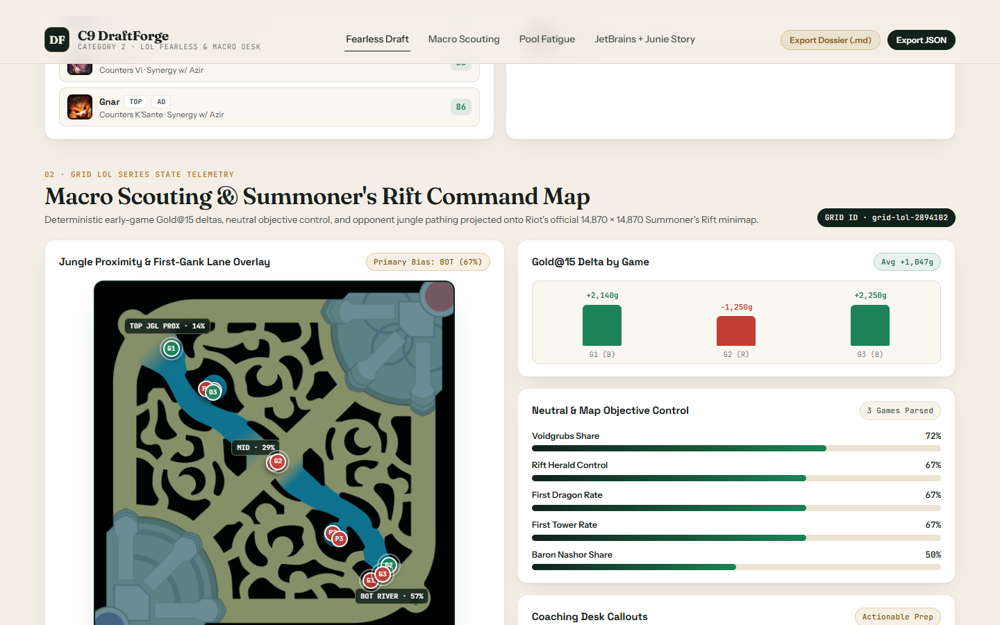
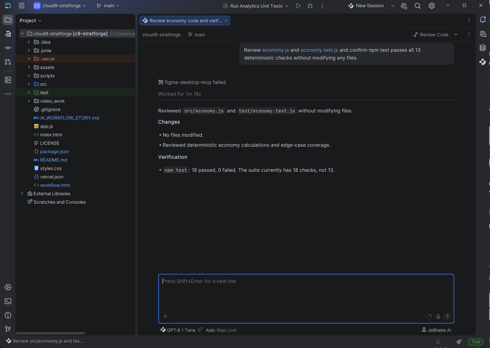

# C9 DraftForge — LoL Macro Scouting & Fearless Draft Management System

> **Cloud9 x JetBrains Hackathon 2026 — Category 2 (League of Legends) + JetBrains AI Workflow Bonus Prize**

[](LICENSE)
[](assets/lol/manifest.json)
[](test/)

**C9 DraftForge** is a zero-build, broadcast-grade League of Legends coaching war room built for Cloud9. It unites an interactive **2025/2026 BO3/BO5 Fearless Draft Manager**, a **Side-by-Side Series Delta & Win-Condition Simulator + Interactive Game 1->5 Fearless Pool Collapse Matrix**, an official **GRID LoL Series State macro scouting parser** projected onto Riot's calibrated Summoner's Rift minimap, and a **Junie-built Fearless Pool-Squeeze & Target Ban engine** — all running locally in native ES Modules with locally vendored Riot Data Dragon patch `16.23.1` champion portraits, hero splashes, and official `map11.png`.

---

## Key Capabilities

### 1. Official 2025/2026 Fearless Draft BO3 / BO5 Manager (`src/fearlessDraft.js`)
- Full 20-step LCS tournament draft order (Ban Phase 1 -> Pick Phase 1 -> Ban Phase 2 -> Pick Phase 2).
- **Hard Cross-Game Fearless Lockouts:** Every champion picked by *either* team in Game 1..N is permanently stamped (`LOCKED G1`, `LOCKED G2`, ...) and disabled across all remaining games, while prior-game bans remain legal.
- **Live Composition Synergy & Damage Split:** Real-time AP/AD/Mixed damage bar, primary comp identity (`Engage`, `Poke`, `Front-to-Back`, `Split`, `Pick`, `Protect`), pro synergy pair callouts, and composition vulnerability warnings.
- **Real-Time Counter-Pick Coach:** Role-filterable (`TOP`, `JGL`, `MID`, `BOT`, `SUP`) recommendations tuned to active picks, open roles, and opponent signature comfort picks.

### 2. GRID LoL Macro Scouting & Calibrated Summoner's Rift Map (`src/gridLolParser.js`, `src/macroAnalytics.js`)
- Parses official GRID LoL Series State JSON (`data.seriesState.games[]`) with **3 built-in pro scouting presets**:
  - `C9 vs Team Liquid — LCS Finals BO5`
  - `C9 vs FlyQuest — Fearless BO3`
  - `C9 vs G2 Esports — MSI Scrim Block`
- **Drag-and-Drop Custom GRID JSON Importer** for any match file.
- Computes deterministic **Gold@15 deltas**, **Objective Control %** (Voidgrubs, Rift Herald, First Dragon, First Tower, Baron), **Jungle Proximity & First-Gank Lane Distribution** projected from Riot world coordinates (`0..14870`, bottom-left origin) onto official `assets/lol/map11.png`, and **Opponent Champion Pool Depth & Fearless Fatigue** cards.
- **1-Click Coach Draft & Macro Dossier Export** (`.md` + `.json`).

### 3. Side-by-Side Series Delta Simulator & Game 1->5 Fearless Pool Collapse Matrix (`src/seriesSimulator.js`)
- **Interactive Game 1->5 Fearless Pool Collapse Matrix:** 5-role (`TOP`/`JGL`/`MID`/`BOT`/`SUP`) × 5-game (`G1..G5` for BO5, dynamically `G1..G3` for BO3) matrix comparing Cloud9 vs Opponent remaining comfort & meta pools as Fearless lockouts accumulate. Highlights the exact **First Role Collapse** (`CRITICAL SQUEEZE` / `EXHAUSTED`) and lets coaches click any cell to inspect exact locked-out vs remaining champions.
- **Side-by-Side Series Delta & Win-Condition Simulator:** Compares **Unconstrained Standard Draft vs Fearless Pool-Squeeze Plan** side-by-side (projected Cloud9 Series Win%, Game 4/5 late-series draft advantage delta, Gold@15 + Voidgrubs synergy impact, and opponent comfort-pool attrition %), controlled via live coaching levers (Target Pinch Role, Ban-Wave Intensity, 6:00 Voidgrub Priority, and 1-click scenario presets) and exported directly into the Markdown & JSON Coach Dossier.

### 4. Fearless Pool-Squeeze & Target Ban Engine (`src/fearlessSqueeze.js`) — Built via Junie CLI TDD
- Built in a real authenticated **JetBrains Junie CLI (`26.11.2`)** red-green TDD sprint (`session-261120-022709-1mth`).
- Scores opponent comfort-pool depletion across all 5 roles (`0..100` Squeeze Index) and recommends the top 3 available target bans that maximize opponent Fearless fatigue.
- Full session artifact committed in [`.junie/sessions/junie-fearless-squeeze-session.json`](.junie/sessions/junie-fearless-squeeze-session.json), plus live WebStorm 2026.3 + JetBrains Air + Junie workspace proof embedded on [`/workflow.html`](workflow.html) & documented in [`AI_WORKFLOW_STORY.md`](AI_WORKFLOW_STORY.md).

---

## Screenshots

| Fearless Draft Desk (G2 with 10 `LOCKED G1` Stamps) | GRID Macro Scouting & Summoner's Rift Command Map | JetBrains WebStorm + Air + Junie Proof |
|---|---|---|
|  |  |  |

---

## Quick Start

Requires **Node.js 22+** (zero external runtime dependencies):

```bash
# Run the complete 31-test deterministic suite (5 suites)
npm test

# Start the zero-build local dev server (http://127.0.0.1:4173)
npm run dev

# Refresh locally vendored Riot Data Dragon portraits, splashes & map11.png
npm run fetch:assets
```

Or open the repository directly in **JetBrains WebStorm** and run the pre-configured `.idea/runConfigurations/` profiles (`C9 DraftForge Dev Server` and `Run Draft & Macro Tests`).

---

## License

Released under the [MIT License](LICENSE). Riot Games assets are fetched from official public Riot Data Dragon CDN (`16.23.1`) for hackathon demonstration purposes.
